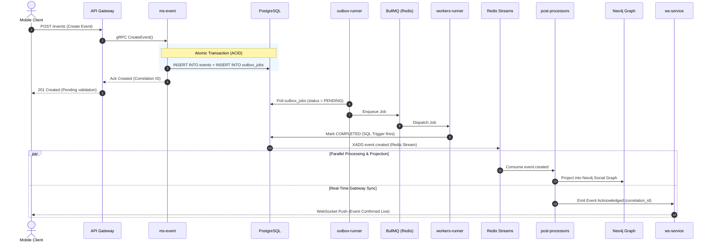

<div align="center">

# Victor Agahi
### Backend & Systems Engineer

**Distributed Systems · Event-Driven Architectures · High-Performance Runtimes**

<p>
  <a href="mailto:victor@agahi.com"></a>
  <a href="https://linkedin.com/in/victor-agahi-49b97b292"></a>
  <a href="https://github.com/VictorAgahi"></a>
</p>

<p align="center">
  <em>Master’s in Computer Science (Software & Systems Engineering) @ EPITA Paris · Ex-Backend SRE Intern @ Padoa</em><br />
  Designing low-latency, event-driven platforms and cross-service systems in <strong>Rust</strong>, <strong>Go</strong>, and <strong>TypeScript</strong>.
</p>

</div>

---

## Core Competencies & Architecture Focus

| Domain | Focus & Architectural Patterns | Core Stack |
| :--- | :--- | :--- |
| **Distributed Systems & Messaging** | Transactional Outbox, Exactly-Once Semantics, Event Sourcing, Scatter-Gather, Compensating Sagas | Kafka, Redis Streams, Valkey, BullMQ |
| **High-Throughput Runtimes** | Incremental AST parsing, immutable snapshot models, Rayon concurrency, zero-copy indexing | Rust, Go, Tree-sitter, Tokio |
| **Zero-Trust Security** | AES-256-GCM encryption at rest, blind indexing, Linux seccomp sandboxing, cascading token auth | Cryptography, Sealed Secrets, Linux seccomp |
| **Cloud-Native & Observability** | GitOps continuous delivery, Restricted Pod Security, distributed tracing, unified telemetry | Kubernetes (K3s), ArgoCD, Traefik, OpenTelemetry |

---

## Technical Arsenal

**Languages**  


**Backend & Systems Runtimes**  


**Data & Messaging**  


**DevOps & Infrastructure**  


**Frontend & Mobile (Supporting)**  


---

## Featured Projects

### [Volontariapp](https://github.com/Volontariapp/meta) — Scalable Event-Driven Volunteering Ecosystem (22 Repositories)

[](https://github.com/Volontariapp)


Enterprise-grade distributed ecosystem orchestrating **22 independent repositories** across microservices, asynchronous stream workers, infrastructure GitOps, shared libraries, and cross-platform clients, architected according to the **C4 model**.

```mermaid
flowchart TD
    subgraph Clients["Clients & Ingestion"]
        Mobile["Mobile App (React Native / Expo 54)"]
        Simulator["Traffic Simulator (Go / Synthetic Load)"]
    end

    subgraph Edge["Edge & Gateways (K3s / Traefik)"]
        Gateway["API Gateway (NestJS / Fastify)"]
        WS["WebSocket Gateway (ws-service)"]
    end

    subgraph Services["Core Domain Microservices (ACID Postgres per service)"]
        User["ms-user (Auth & RBAC)"]
        Event["ms-event (Events Management)"]
        Social["ms-social (Graph & Feeds)"]
        Ranking["ms-ranking (Gamification)"]
        Storage["ms-storage (S3 Assets)"]
    end

    subgraph AsyncBus["Event-Driven Backbone"]
        Outbox["outbox-runner"]
        BullMQ["BullMQ (Redis Queues)"]
        Worker["workers-runner"]
        Streams["Redis Streams (Pub/Sub Event Bus)"]
        PostProc["post-processors (Async Pipeline)"]
    end

    subgraph Data["Persistent Storage"]
        Postgres[("PostgreSQL (Outbox Table)")]
        Neo4j[("Neo4j Graph Database")]
    end

    Mobile -->|REST / HTTPS| Gateway
    Mobile <-->|WSS (Real-time sync)| WS
    Simulator -->|gRPC High-Throughput Load| Gateway

    Gateway -->|gRPC (proto-registry)| User
    Gateway -->|gRPC (proto-registry)| Event
    Gateway -->|gRPC (proto-registry)| Social

    Event -->|1. Atomic Transaction (Entity + Job)| Postgres
    Outbox -->|2. Poll Pending Jobs| Postgres
    Outbox -->|3. Enqueue| BullMQ
    BullMQ -->|4. Execute| Worker
    Worker -->|5. SQL Trigger Notification| Streams
    Streams -->|6. XREADGROUP| PostProc
    PostProc -->|7. Graph Sync & Rollback Saga| Neo4j
    PostProc -->|8. Status Acknowledgment| WS
    WS -->|9. Push Confirmation| Mobile
```

#### Core Architectural Patterns & Highlights

- **Transactional Outbox & Dual-Write Elimination**: Each business mutation atomically commits the domain entity and an `outbox_job` inside the same PostgreSQL ACID transaction. Dual-write discrepancies between the relational datastore and the message bus are mathematically impossible.
- **Job → Audit → Stream Pipeline**: The dedicated [`outbox-runner`](https://github.com/Volontariapp/outbox-runner) dispatches jobs into BullMQ (Redis). A [`workers-runner`](https://github.com/Volontariapp/workers-runner) processes jobs and commits execution logs, firing an **automatic PostgreSQL trigger** that streams events into Redis Streams for multi-subscriber ingestion by [`post-processors`](https://github.com/Volontariapp/post-processors).
- **Asynchronous Scatter-Gather & Compensating Sagas**: When a volunteer mission or social event is scheduled, concurrent post-processors execute geocoding, ranking calculations, and Neo4j graph projections in parallel. The [`ws-service`](https://github.com/Volontariapp/ws-service) aggregates acknowledgments via `correlation_id` before notifying connected clients via WebSocket, executing a rollback Saga in case of partial graph write failure.
- **Contract Governance via Protobuf Registry**: All inter-service communications rely on strongly-typed gRPC interfaces governed within [`proto-registry`](https://github.com/Volontariapp/proto-registry), automating code generation for Go, TypeScript, and Python stubs.
- **Resilience & Synthetic Load Testing**: High-throughput benchmarking and real-time stress testing driven by [`traffic-simulator`](https://github.com/Volontariapp/traffic-simulator), validating backpressure thresholds and WebSocket connection churn under peak loads.
- **Hardened GitOps Kubernetes Delivery**: Managed across [`deploy`](https://github.com/Volontariapp/deploy) on K3s with ArgoCD overlays, adhering to **Restricted Pod Security Standards** (non-root execution, read-only root filesystems, seccomp profiles, Bitnami Sealed Secrets, and default-deny NetworkPolicies).



---

### [Causal Mesh](https://github.com/VictorAgahi/causalmesh) — High-Performance Polyglot Codebase Graph & MCP Server


Local-first [Model Context Protocol](https://modelcontextprotocol.io) (MCP) server written in Rust that builds an in-memory structural knowledge graph of large polyglot codebases to empower AI coding agents (Claude Code, Cursor, Windsurf) with instant cross-service context.

- **Cross-Service Contract & Dependency Graph**: Discovers and maps cross-boundary relationships across Protobuf definitions, gRPC servers/clients (`*ImplBase`, stubs, wire breaking change detection against Git base), Kafka producers/consumers, BullMQ queues, OpenAPI/AsyncAPI specs, and declarations across 10+ languages (Rust, Go, TypeScript, Python, Java, Kotlin, C#).
- **High-Throughput Tree-sitter Pipeline**: Parallel AST extraction using Tree-sitter across Rayon worker threads protected by strict `AstGuard` invariants (guarding against binary files, nesting depth > 64, oversized lines, and parser stalls).
- **Persistent LRU Cache & Atomic Snapshots**: Workspace-scoped SQLite cache storing pre-parsed AST trees for sub-second warm boots; file changes are incrementally reconciled into an immutable, in-memory graph (`MeshSnapshot`) swapped atomically.
- **Daemon Architecture (`meshd`)**: Stdio JSON-RPC proxy connecting to a background daemon over Unix domain sockets (or named pipes), deduplicating indexing across editor windows with FSEvents/inotify change coalescing.
- **Hardened Security & RSAH Governance**: Completely offline with zero outbound network client code, Linux seccomp thread sandboxing (blocking socket creation), Unicode-canonicalized path sandboxing (`ValidatedScope`), automated secret masking, and SHA-256 tamper-evident SQLite audit trails.

---

### [VaultedMind](https://github.com/VictorAgahi/VaultedMind) — Zero-Trust Mental Health Vault


Full-stack application for journaling mood and personal reflections without ever exposing raw data, even internally.

- **Encryption at Rest**: Each sensitive field is encrypted with AES-256-GCM before persistence; email addresses are protected with blind indexing to allow searching without revealing PII.
- **Strict Network Isolation**: Kubernetes NetworkPolicies guaranteeing that only the frontend communicates with the backend, and only the backend communicates with the database.
- **AI Insights Module** (`ai-insights`): Built in NestJS with hexagonal architecture (`domain` / `application` / `infrastructure`); a `data-sanitizer.service` anonymizes logs and journals before any LLM invocation, a `prompt.service` constructs structured prompts, and scheduled cron jobs periodically generate personalized insights.
- **CI/CD & Security**: GitHub Actions pipelines with secret scanning, automated GitOps deployments via ArgoCD and Kustomize.

---

### [SentiGraph Finance](https://github.com/VictorAgahi/sentigraph-finance) — Real-Time Crypto Market Intelligence


Low-latency polyglot microservices architecture composed of four independent services interconnected through a Redis (DragonflyDB) backbone:

- **Harvester (Rust)**: High-frequency ingestion of Binance Futures WebSocket streams (ticker, order book depth, liquidations) with automatic exponential backoff reconnection.
- **Analyst (Go)**: Worker pool for sentiment analysis via Ollama, batch persistence in TimescaleDB, and real-time broadcasting via WebSocket.
- **Scout (Go)**: Multi-source RSS and Nitter intelligence monitoring pipeline, dispatched to Analyst for sentiment scoring.
- **Dashboard (Next.js)**: Financial monitoring terminal powered by `lightweight-charts`, featuring sub-second updates driven by WebSockets.

---

### [NightQuizz](https://github.com/MasterNIghtQuizz/head) — Live Quiz Platform & DDD Microservices


Yarn monorepo (Fastify + Domain-Driven Design) partitioned into five services: `api-gateway`, `ms-user`, `ms-quiz-management`, `ms-session`, `ms-response`, plus a dedicated real-time `ws-service`.

- **Cascading Zero-Trust Auth**: The API gateway verifies the external JWT, then mints a request-scoped internal token signed with RSA; each downstream microservice validates it via Fastify hooks (`hookAccessToken`/`hookInternalToken`), never trusting direct internal calls.
- **Guaranteed Kafka Idempotency**: Every event (`USER_CREATED`, etc.) carries a unique UUID `eventId`; consumers check it against a `processed_events` table within the same TypeORM transaction, ensuring *exactly-once* processing despite Kafka's *at-least-once* semantics.
- **Valkey as Shared Cache & Broker**: Open-source Valkey (Redis fork) deployed across microservices via dedicated Kubernetes manifests (`k8s/services/cache`).
- **End-to-End Observability**: OpenTelemetry for distributed tracing, Jaeger for trace visualization, OpenSearch + Dashboards for centralized logging, and custom Grafana/Prometheus dashboards.
- **Deployment**: Multi-profile Docker Compose (`infra`/`app`) for local development, K8s manifests with ArgoCD overlays for production.

---
